<div align="center">



<a href="https://github.com/nambiropeter">
  
</a>

<br/>

[](mailto:anthonynambiropeter@gmail.com)
[](#)
[](https://github.com/nambiropeter/WordQuest)

</div>

<br/>

```swift
struct Anthony {
    let base      = "Nairobi, Kenya 🇰🇪"
    let role      = "Student developer — mobile, web and systems"
    let shipping  = "WordQuest → App Store review, Android build alongside"
    let stack     = ["Swift", "Kotlin", "TypeScript", "C", "Python"]
    let enjoys    = ["finishing things", "clean UI", "markets & AI news", "Batman / Iron Man"]

    func motto() -> String { "Prototype fast. Ship properly." }
}
```

## ⚡ Featured work

<table>
  <tr>
    <td width="50%" valign="top">
      <h3><a href="https://github.com/nambiropeter/WordQuest">🧩 WordQuest — iOS</a></h3>
      Word search + trivia game: 8 themes × 1,000 levels, 15k+ trivia questions, local multiplayer, Game Center leaderboards & achievements, iCloud sync and a Dynamic Island Live Activity.
      <br/><br/>
      
      
      
      
    </td>
    <td width="50%" valign="top">
      <h3><a href="https://github.com/nambiropeter/WordQuest-Android">🤖 WordQuest — Android</a></h3>
      The native Android sibling, built in Kotlin with Jetpack Compose and sharing the same content, level generator and game design as the iOS app.
      <br/><br/>
      
      
      
    </td>
  </tr>
  <tr>
    <td width="50%" valign="top">
      <h3><a href="https://github.com/nambiropeter/kite-compiler">🛠️ Kite Compiler</a></h3>
      A compiler front-end for Kite, a small imperative language: lexer, recursive-descent parser, AST, semantic analysis, error recovery and quadruple IR generation, with regression tests and CI.
      <br/><br/>
      
      
    </td>
    <td width="50%" valign="top">
      <h3><a href="https://github.com/nambiropeter/ubersicht-hud-dashboard">🖥️ HUD Desktop Dashboard</a></h3>
      A macOS heads-up display for Übersicht: live service health, tech markets, AI news, weather, mail and system stats, all rendered on the desktop.
      <br/><br/>
      
      
    </td>
  </tr>
  <tr>
    <td width="50%" valign="top">
      <h3><a href="https://kpolls-frontend.vercel.app">🗳️ KPolls Kenya</a> · <a href="https://github.com/nambiropeter/2027-election">code</a></h3>
      A live 2027 presidential preference poll with one vote per device — no login required — and real-time tallies.
      <br/><br/>
      
    </td>
    <td width="50%" valign="top">
      <h3><a href="https://minara-safaris.vercel.app">🦁 Minara Safaris</a> · <a href="https://github.com/nambiropeter/minara-safaris">code</a></h3>
      Website for a Kenyan safari company, built with Next.js and TypeScript.
      <br/><br/>
      
      
    </td>
  </tr>
</table>

<sub>Also: <a href="https://realtime-voting-site.vercel.app">real-time voting site</a> (Express + Socket.IO) · <a href="https://github.com/nambiropeter/stock-market-predictor">stock market predictor</a> · <a href="https://github.com/nambiropeter/C-projects">C projects</a></sub>

## 🧰 Toolkit

<div align="center">


<br/>


</div>

## 📈 Activity

<div align="center">

<picture>
  <source media="(prefers-color-scheme: dark)" srcset="https://raw.githubusercontent.com/nambiropeter/nambiropeter/output/snake-dark.svg" />
  <source media="(prefers-color-scheme: light)" srcset="https://raw.githubusercontent.com/nambiropeter/nambiropeter/output/snake.svg" />
  
</picture>

</div>

<div align="center">
<sub><code>// prototype fast · ship properly · keep building</code></sub>
</div>
